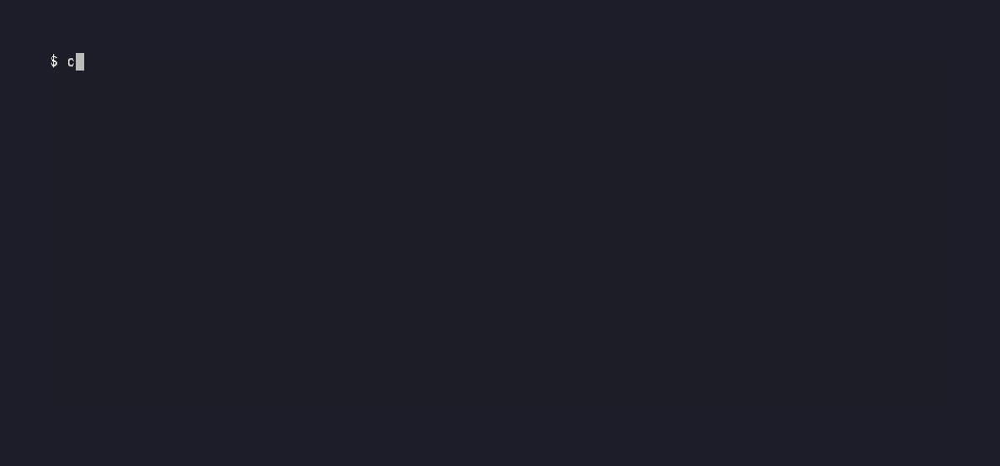

# vuln-patterns

[](https://github.com/ucsurf/vuln-patterns/actions/workflows/test.yml)
[](https://github.com/ucsurf/vuln-patterns/releases/latest)
[](LICENSE)
[](https://scorecard.dev/viewer/?uri=github.com/ucsurf/vuln-patterns)

Semgrep rules distilled from **real, publicly disclosed vulnerabilities** found by [uc.surf](https://uc.surf/findings/).
Every rule links to the published report / GitHub advisory it came from, and ships with
positive (`ruleid`) and negative (`ok`) test cases.



## Why

Generic rule packs cover well-known sinks. The bugs that become advisories are usually subtler: a sanitizer whose output gets decoded again, a PKCS#7 parser that trusts the first certificate, or a decoder with no depth limit. Each rule here encodes one such pattern from a real, published advisory, so you can check whether your code repeats a mistake that has already been exploited somewhere else.

## Usage

```sh
git clone --depth 1 https://github.com/ucsurf/vuln-patterns
semgrep --config vuln-patterns/rules/ path/to/code
# a single rule
semgrep --config vuln-patterns/rules/go/crypto/pkcs7-first-cert-as-signer.yaml path/to/code
```

### Example (real output, semgrep 1.x)

```console
$ cat docs/demo/app.py
import html, bleach

def render(comment):
    return html.unescape(bleach.clean(comment))

$ semgrep --config rules/ docs/demo/app.py --metrics=off
┌────────────────┐
│ 1 Code Finding │
└────────────────┘

    docs/demo/app.py
   ❯❯❱ rules.python.xss.sanitizer-output-mutated-after-clean
          ❰❰ Blocking ❱❱
          HTML is decoded/unescaped after sanitization. Any
          transformation after the sanitizer can reintroduce markup
          (sanitizer bypass / mXSS). Sanitize last.

            4┆ return html.unescape(bleach.clean(comment))
```

## GitHub Actions

```yaml
jobs:
  vuln-patterns:
    runs-on: ubuntu-latest
    permissions: { contents: read }
    steps:
      - uses: actions/checkout@11bd71901bbe5b1630ceea73d27597364c9af683 # v4.2.2
        with: { persist-credentials: false }
      - uses: actions/checkout@11bd71901bbe5b1630ceea73d27597364c9af683 # v4.2.2
        with: { repository: ucsurf/vuln-patterns, ref: v0.1.2, path: .vuln-patterns, persist-credentials: false }
      - run: pipx run semgrep==1.183.0 --config .vuln-patterns/rules/ --error --metrics=off --exclude .vuln-patterns .
```

## pre-commit

Use Semgrep's own hook and point it at a checkout of these rules (for example a git submodule at `.vuln-patterns`):

```yaml
repos:
  - repo: https://github.com/semgrep/pre-commit
    rev: v1.183.0
    hooks:
      - id: semgrep
        args: ["--config", ".vuln-patterns/rules/", "--error", "--metrics=off", "--skip-unknown-extensions"]
```

## Rules

| Rule | Language | Pattern | CWE | Source |
|---|---|---|---|---|
| [`length-check-addition-overflow`](docs/length-check-addition-overflow.md) | c | Overflowing length check | CWE-190 | [uc.surf CEmu](https://uc.surf/findings/security/c/CE-Programming__CEmu/2026-10-16-cert-field-get-length-overflow-oob-read/) · GHSA-qfrc-22x5-wpfc |
| [`pkcs7-first-cert-as-signer`](docs/pkcs7-first-cert-as-signer.md) | go | First PKCS#7 certificate assumed to be signer | CWE-347 | [uc.surf pdfsign signer](https://uc.surf/findings/security/go/digitorus__pdfsign/2026-10-06-signer-certificate-confusion/) · GHSA-2wq3-cx7v-37f3 |
| [`x509-verify-time-from-untrusted-timestamp`](docs/x509-verify-time-from-untrusted-timestamp.md) | go | Validation time from untrusted timestamp | CWE-295 | [uc.surf pdfsign timestamp](https://uc.surf/findings/security/go/digitorus__pdfsign/2026-10-06-untrusted-timestamp-sets-validation-time/) · GHSA-v2pw-gwrw-2p72 |
| [`make-slice-unchecked-length`](docs/make-slice-unchecked-length.md) | go | Unchecked slice length from parsed data | CWE-789 | [uc.surf pdfsign ByteRange](https://uc.surf/findings/security/go/digitorus__pdfsign/2026-10-06-fluent-verify-byterange-panic-dos/) · GHSA-c8v6-r46j-hm35 |
| [`recursive-decoder-without-depth`](docs/recursive-decoder-without-depth.md) | go | Recursive decoder without depth limit | CWE-674 | [uc.surf msgpack](https://uc.surf/findings/security/go/shamaton__msgpack/2026-10-04-decode-nesting-stack-overflow/) · GHSA-73g6-2xj8-223q |
| [`templ-safeurl-dynamic`](docs/templ-safeurl-dynamic.md) | go | Dynamic value marked safe URL/JS | CWE-79 | [uc.surf templ URL attrs](https://uc.surf/findings/security/go/a-h__templ/2026-10-06-url-attribute-sanitization-gap/) · GHSA-94c2-xg24-pwhv; [uc.surf templ script literal](https://uc.surf/findings/security/go/a-h__templ/2026-10-06-script-template-literal-interpolation-xss/) · GHSA-jq3r-rjqp-mwgj |
| [`sso-trust-email-verified`](docs/sso-trust-email-verified.md) | javascript, typescript | SSO trusts provider email_verified | CWE-287 | [uc.surf caomei-auth](https://uc.surf/findings/security/javascript/CaoMeiYouRen__caomei-auth/2026-10-27-sso-trust-email-verified-account-takeover/) · GHSA-785j-54p4-vxw9 |
| [`express-mutating-route-missing-authz`](docs/express-mutating-route-missing-authz.md) | javascript, typescript | State-changing route without authz middleware | CWE-862 | [uc.surf caomei-auth](https://uc.surf/findings/security/javascript/CaoMeiYouRen__caomei-auth/2026-10-27-sso-trust-email-verified-account-takeover/) · GHSA-785j-54p4-vxw9 (related: route open to any user) |
| [`ajv-addschema-untrusted-id`](docs/ajv-addschema-untrusted-id.md) | javascript, typescript | Untrusted schema `$id` override | CWE-915 | — |
| [`prisma-update-unfiltered-input`](docs/prisma-update-unfiltered-input.md) | javascript, typescript | Unfiltered Prisma input (mass assignment) | CWE-915 | [uc.surf MyFit](https://uc.surf/findings/security/javascript/WhyAsh5114__MyFit/2026-10-27-mesocycle-editbyid-mass-assignment-account-takeover/) · GHSA-jhfj-c242-ghx4 |
| [`svg-doctype-regex-strip`](docs/svg-doctype-regex-strip.md) | php | Regex DOCTYPE stripping (encoding bypass) | CWE-838 | [uc.surf svg-sanitizer](https://uc.surf/findings/security/php/darylldoyle__svg-sanitizer/2026-10-04-utf16-bom-bypass-removedoctype/) · GHSA-vjg7-f2wj-gqqh |
| [`bytes-accumulate-in-loop`](docs/bytes-accumulate-in-loop.md) | python | Quadratic bytes accumulation in decoder loop | CWE-407 | [uc.surf pyasn1](https://uc.surf/findings/security/python/pyasn1__pyasn1/2026-10-03-constructed-bitstring-quadratic-decode/) · GHSA-2qm8-x737-gmw5 / CVE-2026-119196 |
| [`sanitizer-output-mutated-after-clean`](docs/sanitizer-output-mutated-after-clean.md) | python | Transform after sanitize (Python) | CWE-79 | — |
| [`create-then-set-permissions`](docs/create-then-set-permissions.md) | rust | Create-then-chmod permission window | CWE-732 | [uc.surf bzip2-cli](https://uc.surf/findings/security/rust/trifectatechfoundation__libbzip2-rs/2026-10-06-bzip2-cli-decompress-output-permissions/) · GHSA-4j37-jjpm-9865 |
| [`ammonia-svg-animation-tags`](docs/ammonia-svg-animation-tags.md) | rust | SVG animation tags allowed in sanitizer | CWE-79 | [uc.surf ammonia](https://uc.surf/findings/security/rust/rust-ammonia__ammonia/2026-10-05-animatetransform-animation-xss-bypass/) · GHSA-f2pc-rwv3-69mv |

## Comparison with other rule packs

- [semgrep-rules](https://github.com/semgrep/semgrep-rules) is broad and generic; [0xdea/semgrep-rules](https://github.com/0xdea/semgrep-rules) targets C/C++; [trailofbits/semgrep-rules](https://github.com/trailofbits/semgrep-rules) focuses on Go/Python/ML.
- Here every rule starts from a disclosed bug with an advisory, covering niches the others miss: sanitizer allow-lists and post-sanitize transforms, PKCS#7 signer confusion, untrusted timestamps, decoder depth/quadratic DoS, Prisma mass assignment, SSO email trust.
- Each rule has a short write-up in [`docs/`](docs/).

## Limitations

- These rules are pattern-based and mostly intra-procedural. A finding is a lead to review, not proof of a vulnerability. If data flows through helper functions across files, expect misses.
- Each rule covers the API shape from its source advisory (bleach/html, Prisma, ajv, templ, ...). Other libraries with the same bug class are not covered.
- The rules are tested with Semgrep 1.183.0 (OSS engine). Older versions may reject some syntax.

## Development

```sh
semgrep --validate --config rules/
semgrep --test rules/
yamllint rules/
vhs docs/demo.tape   # regenerate docs/demo.gif from docs/demo/app.py
```

Only patterns from **published** findings are added. Embargoed reports never land here.

## License

MIT, see [LICENSE](LICENSE).
